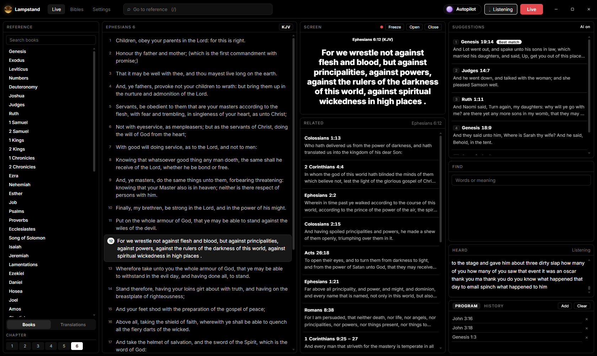

<p align="center"></p>

<h1 align="center">Lampstand</h1>

<p align="center"><b>Scripture on screen, as it's preached.</b><br/>
Free, open-source church software that listens to the sermon and puts each verse on the projector by itself.<br/>
It runs on the church computer. Nothing is sent anywhere and there is nothing to pay for.</p>

<p align="center"><a href="https://nnadijoshuac.github.io/lampstand/">Website</a> · <a href="../../releases/latest">Download for Windows</a> · <a href="#build-from-source">Build from source</a></p>

<p align="center"></p>

---

## What it does

- **Hears every reference.** "Ephesians chapter six, verse ten", "the fifth chapter of Romans", "First John four, eight and then sixteen". It copes with accents and mishearings ("official chapter six" is Ephesians 6).
- **Follows the reading.** As the preacher reads, the screen moves verse by verse on its own, and keeps going if they read past the verse they announced. "Next verse", "go on", "go back to verse two", "the next chapter, verse four" all work.
- **Finds verses from a description.** "Saul has slain his thousands", "the eye of a needle", "Satan departed for a season": the verse is found from what was said, checked against its text, and put up.
- **Shows what is read, not just what is said.** If the preacher names one reference and reads another, Lampstand follows the words being read.
- **Any translation.** "Read that in the Amplified." Star a favourite and Lampstand comes back to it for each new passage.
- **Autopilot or Assist.** Let it drive the screen, or have it suggest while the operator decides. The operator can take over at any time.
- **Moving from Bible Show?** Import your Bible Show Bibles (`.bib` files, or the downloadable installers directly) and your projector themes (Settings, Projector, *Import from Bible Show*).
- **A proper projector.** Full screen or lower third, black / cream / green-screen, transitions, words of Jesus in red, and it finds the second display by itself and comes back when HDMI is reconnected.

## Translations

The King James Version comes with Lampstand. In the app, open Bibles and choose **Add translation**:

- **Get online** lists the free translations on the website (ASV, Berean Standard, BBE, Darby, Geneva, NHEB, Webster, Young's Literal) and adds one in a click.
- **Upload a file** takes a Lampstand Bible file (`.lamp.json`) or a Bible Show version (the `.exe` installer or the `.bib` inside it). Translations that belong to publishers (NIV, NKJV, Amplified and others) can be downloaded free from Bible Show and added this way.

A Lampstand Bible is plain JSON, described in `src/shared/lampBible.ts`. `scripts/build-bibles.py` builds the website's files from public-domain sources.

## How it works

| Piece | Where |
|---|---|
| Speech recognition: Underdog Bark 3.0 Plus (Conway Research), exported to ONNX and run natively in Rust | `src-tauri/src/bark.rs` |
| On-device AI for descriptions and loose instructions: Qwen2.5 1.5B Instruct via llama.cpp, at low priority so listening never waits | `src-tauri/src/llm.rs`, `src/app/ai.ts` |
| Spoken references, numbers and mishearings | `src/shared/reference.ts` |
| Follows the reading word by word (Smith-Waterman alignment against the verse text) and spoken navigation | `src/shared/tracker.ts` |
| Search by meaning (MiniLM sentence embeddings, precomputed) plus keyword search | `src/app/search.ts` |
| Bible Show `.bib` (Jet 4 database) and installer import, themes | `src/shared/bib.ts`, `src/shared/nsis.ts`, `src/shared/bsTheme.ts` |
| Projector window and themes | `src/app/Output.tsx`, `src/app/projector.ts` |

Everything runs locally. The app ships with the King James Version; other translations are imported by the church.

## Build from source

Requirements: Node 20+, Rust (stable), and on Windows the WebView2 runtime (built into Windows 10 and 11).

```
npm install
npm test               # reference parser, tracker and theme tests
npm run tauri dev      # run the app
npx tauri build --no-bundle
```

The speech and AI models are too large for git. Download the Windows release zip and copy its `models` and `llm` folders into `src-tauri/`:

- `src-tauri/models/bark/`: Bark 3.0 Plus as ONNX (`encoder.onnx`, `decoder_joint.onnx`, `preprocessor.onnx`, `vocab.txt`)
- `src-tauri/llm/`: `llama-server` and `model.gguf` (Qwen2.5-1.5B-Instruct Q4_K_M)

**macOS and Linux:** the app itself is cross-platform (Tauri). Replace the Windows `llama-server.exe` and its DLLs in `src-tauri/llm/` with a llama.cpp build for your platform (keep `model.gguf`), then build as above. Ready-made macOS and Linux builds are coming.

## Credits and licences

Lampstand is released under the MIT licence (see `LICENSE`). It builds on:

- **Underdog Bark 3.0 Plus** by Conway Research, derived from NVIDIA Parakeet TDT 0.6B v3 and Moondream Parakeet Ultra, CC BY 4.0 (see `src-tauri/models/bark/NOTICE` in the release)
- **Qwen2.5 1.5B Instruct** by Alibaba Cloud, Apache 2.0
- **llama.cpp** (MIT), **ONNX Runtime** (MIT), **Tauri** (MIT / Apache 2.0)
- **all-MiniLM-L6-v2** (Apache 2.0) for search by meaning
- Cross references from **OpenBible.info** (CC BY)
- The King James Version text (public domain)

Lampstand is not affiliated with Bible Show; Bible Show is a trademark of its owner. No Bible Show files are included.
